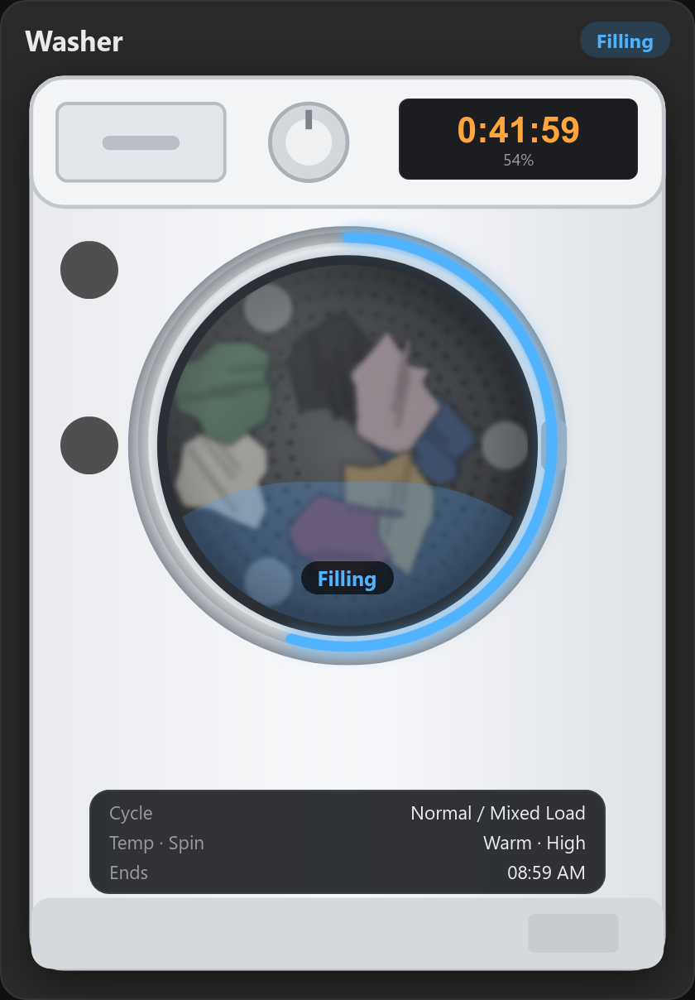
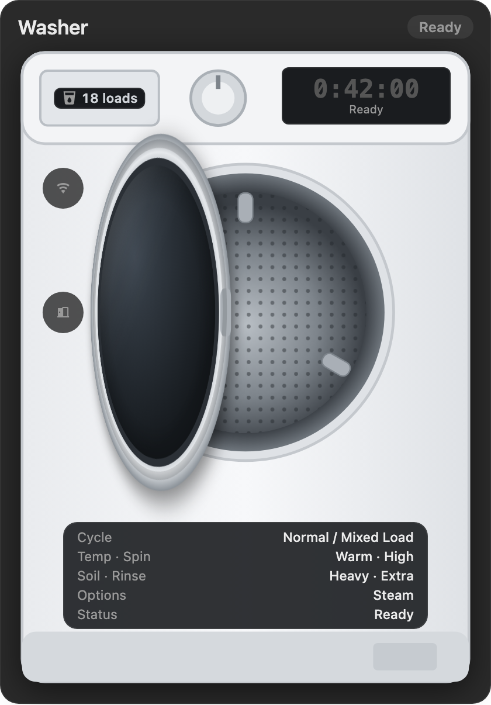
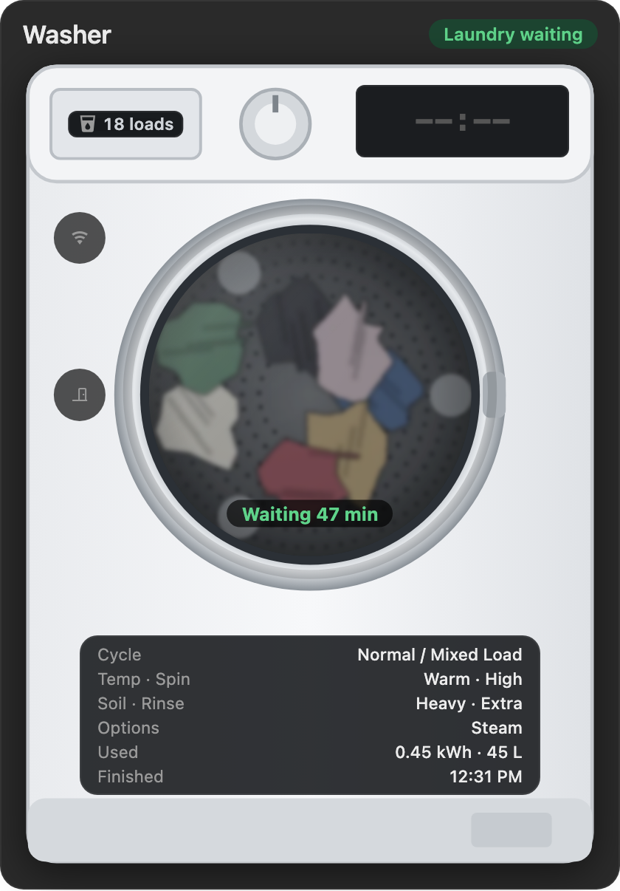
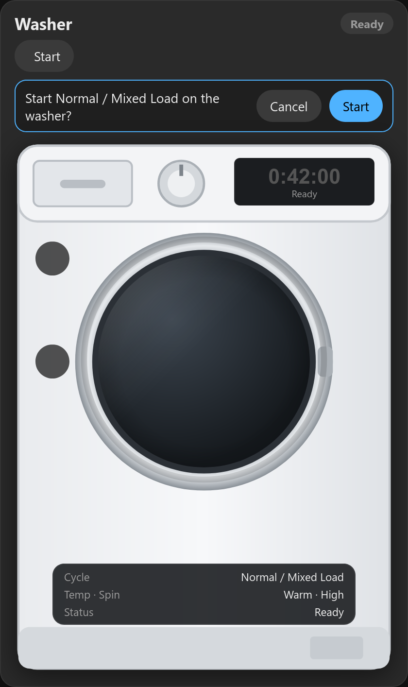
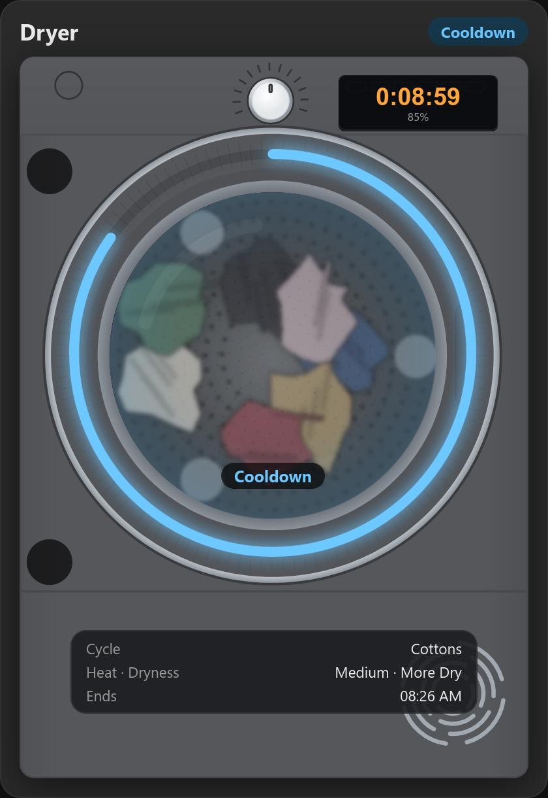

# GE Appliance Card for Home Assistant

A washer, tumble dryer and washer dryer card for **GE Appliances** machines (**GE, GE Profile, Café**) that use the
[GE Home (SmartHQ)](https://github.com/simbaja/ha_gehome) integration.

The machine is drawn on the card with a progress ring round the door, the time left on its display, and the
laundry turning while it runs. When Remote Enable is on, you can start the cycle you chose on the machine from the card.

> **Beta.** The GE support was written by [@kedube](https://github.com/kedube), and the card is tested against
> simulated states. If you try it, please [open an issue](../../issues) with your model and what you see.
> That's how it gets out of beta.

Sister card of the [hOn washer & dryer card](https://github.com/spikey1965/ha-hon-appliance-card) (Haier, Candy, Hoover),
the [Candy card](https://github.com/spikey1965/ha-candy-appliance-card) and the [Miele card](https://github.com/spikey1965/ha-miele-appliance-card).



## What it shows

- Status: Off, Ready, Scheduled (delayed start), Running with the phase (Filling, Washing, Rinse, Spin, Drying, Cooldown ...), Paused, Finished
- Time left on the machine's display, the end time, and a progress ring round the door
- The cycle, plus wash temperature and spin, soil and rinse (washer) or heat and dryness (dryer)
- The options chosen for the cycle, when any are on: Steam, Prewash, TimeSaver, TumbleCare (washer) or Extended Tumble,
  EcoDry, WasherLink (dryer)
- **SmartDispense:** the loads of detergent left, on the dispenser drawer. It turns amber when GE says the tank is low.
- Dryer sheets left, for dryers that report them
- The door swings open when you open it. Paused mid-cycle you see the laundry in the drum; once the cycle's finished,
  the drum's empty.
- The washer's door lock (if your machine has one) and Remote Enable
- Warnings above the machine for a **blocked vent** (dryer), a **drain timeout** (washer) and **low detergent**
- **Laundry waiting:** after a cycle, if the door hasn't been opened, the laundry stays in the window with how long
  it's waited, and the card says "Laundry waiting" until you open the door
- **Energy and water used** by the cycle (and gas, for a gas dryer), so far while it runs and for the cycle it's just
  finished. Litres or gallons, following Home Assistant's unit system.
- **Washer dryers** (`appliance: combo`): blue with water while it washes, orange with heat while it dries, with the
  washing or drying settings for what it's doing
- A **Start** button for the cycle chosen on the machine. It asks before starting.

The soil, options, SmartDispense, dryer-sheet and energy rows only show when your machine reports them.







**Limits that come from the integration:**
- GE Home can't pause, resume, stop or switch off a machine, or choose a cycle. Choose the cycle on the machine, press
  **Remote Enable**, then **Start** on the card.
- GE only reports the time left. The progress ring uses Home Assistant's history to find when the cycle started, so it
  stays right after a pause. History is on unless you've excluded the machine-state sensor from the recorder.
- Laundry waiting and the energy used come from the history too: the machine state and door for one, the machine's
  `resource_cumulative_...` sensors for the other. After Home Assistant restarts, the door looks as if it's just
  changed, so a load that was already waiting isn't flagged.
- Energy and water need GE Home 2026.6 or newer, and a machine that reports them. Many don't.
- No cycle count, because GE doesn't report one.

## Requirements

- Your washer and/or dryer in the **SmartHQ** app on your phone.
- **[GE Home (SmartHQ)](https://github.com/simbaja/ha_gehome)** version 2025.12 or newer, from HACS. Restart Home
  Assistant, then add **GE Home (SmartHQ)** under **Settings → Devices & services**.

## Install

**HACS:** HACS → ⋮ → Custom repositories → add `https://github.com/spikey1965/ha-ge-appliance-card`, type **Dashboard**.
Then find "GE Appliance Card", download it, and reload the browser. While it's a pre-release, open it in HACS
and switch on "Show beta versions" if it isn't offered.

**Manual:** copy `ge-appliance-card.js` to `/config/www/`, then add a dashboard resource
(Settings → Dashboards → ⋮ → Resources): `/local/ge-appliance-card.js?v=0.2.0`, type **JavaScript module**.

It can sit alongside the hOn card. They use different card names.

## Use

```yaml
type: custom:ge-appliance-card
appliance: washer
```

```yaml
type: custom:ge-appliance-card
appliance: dryer
```

```yaml
type: custom:ge-appliance-card
appliance: combo
```

Or add it from the dashboard: **Add card → GE appliance**. The visual editor lists the GE machines it finds by name, so
you can pick one without looking up entity IDs. Your own cycle `names` are set in the code editor.

The card finds your machine by itself: the first GE washer (or dryer, or washer dryer). A washer or dryer card also
shows a washer dryer if that's the only GE machine you have.

GE entity IDs start with the machine's serial number, for example `sensor.zl123456g_laundry_machine_state`, or with its
MAC address (`sensor.aa_bb_cc_dd_ee_ff_laundry_machine_state`), depending on the **Device identifier** in GE Home's
**Configure** options. If you have more than one GE washer or dryer, search **Settings → Entities** for
`laundry_machine_state` and set `entity` to the part before `_laundry_machine_state`:

```yaml
type: custom:ge-appliance-card
appliance: dryer
entity: gd987654
```

| Option | Default | What it does |
|---|---|---|
| `appliance` | `washer` | `washer`, `dryer` or `combo` (a washer dryer) |
| `entity` | first GE machine | the serial number or MAC address at the start of the entity IDs |
| `name` | Washer / Dryer / Washer Dryer | card title |
| `colour` | blue / orange | accent colour, e.g. `"#4fb3ff"`. A washer dryer is blue, and orange while it dries, unless you set one. |
| `names` | none | your own cycle names, e.g. `Normal Or Mixed Load: Everyday` (as GE Home reports it, or as the card shows it) |
| `style` | `drawn` | `photo` = a more detailed illustration |
| `finish` | `white` | machine colour: `white`, `graphite` or `black` |
| `max_width` | `440px` | |
| `images` | built in | a folder with your own `washer.svg`, `dryer.svg` and `laundry-drum.webp`. With your own pictures and `style: photo` the door doesn't swing open, because it's part of your picture. |
| `hide` | none | what to leave out: `soil`, `options`, `detergent` (also stops the low detergent warning), `sheets`, `usage` (energy and water used) and `waiting` (laundry waiting), e.g. `hide: [detergent]` if you don't use SmartDispense |



## Notifications

The card shows warnings while you're looking at it. To be told on your phone, add an automation. Use your own entity IDs,
and your phone's notify action (for example `notify.mobile_app_your_phone`) in place of `notify.notify`:

```yaml
alias: Dryer vent blocked
triggers:
  - trigger: state
    entity_id: binary_sensor.gd987654_laundry_dryer_blocked_vent_fault
    to: "on"
actions:
  - action: notify.notify
    data:
      title: Dryer vent blocked
      message: Clean the lint filter and check the exhaust duct.
```

```yaml
alias: Washer detergent low
triggers:
  - trigger: state
    entity_id: sensor.zl123456g_laundry_washer_smart_dispense_tank_status
    to: "Low"
actions:
  - action: notify.notify
    data:
      title: Detergent low
      message: >-
        {{ states('sensor.zl123456g_laundry_washer_smart_dispense_loads_left') }} loads left in SmartDispense.
```

A reminder if the washer finishes and the door isn't opened within 30 minutes. It waits for the door rather than for
the machine to stay Finished, because some machines switch themselves off:

```yaml
alias: Laundry waiting in the washer
triggers:
  - trigger: state
    entity_id: sensor.zl123456g_laundry_machine_state
    to: Finished
actions:
  - wait_for_trigger:
      - trigger: state
        entity_id: binary_sensor.zl123456g_laundry_door
        to: "on"
    timeout: "00:30:00"
  - if:
      - condition: template
        value_template: "{{ not wait.trigger }}"
    then:
      - action: notify.notify
        data:
          title: Laundry waiting
          message: The washer finished 30 minutes ago and the door hasn't been opened.
```

## Troubleshooting

- **No Start button:** press Remote Enable on the machine, and make sure it's on and showing Ready (Standby). There's
  no Start while a cycle is running, because GE Home can't send anything else.
- **Card shows Off and "—" everywhere:** the card didn't find a GE washer (or dryer). Set `entity` as shown above.
- **The door doesn't open in the picture:** the card follows `binary_sensor.<id>_laundry_door`. Check it changes in
  Developer Tools → States when you open the door. With your own `images` and `style: photo` the door stays closed.
- **No detergent on the drawer:** your washer doesn't report SmartDispense (`sensor.<id>_laundry_washer_smart_dispense_loads_left`).
- **No "Used" row:** your machine doesn't report running totals (search **Settings → Entities** for
  `resource_cumulative`), or they're excluded from the recorder, so their history isn't there.
- **"Laundry waiting" when it isn't:** the card follows the door sensor; if the door was opened while Home Assistant
  was down, the card can't know. Open and close the door, or add `waiting` to `hide`.
- **Something else looks wrong:** please open an issue with your model and a screenshot of Developer Tools → States
  filtered for `laundry`.

## Thanks

GE support written by **[@kedube](https://github.com/kedube)**. Thanks to **simbaja** for the GE Home integration.
Card by [My Media Build](https://mymediabuild.uk). If you find it useful, you can [buy me a coffee](https://buymeacoffee.com/bobgreggr) ☕ (no pressure).

## Licence

MIT. Not affiliated with or endorsed by GE Appliances, Haier or SmartHQ.
